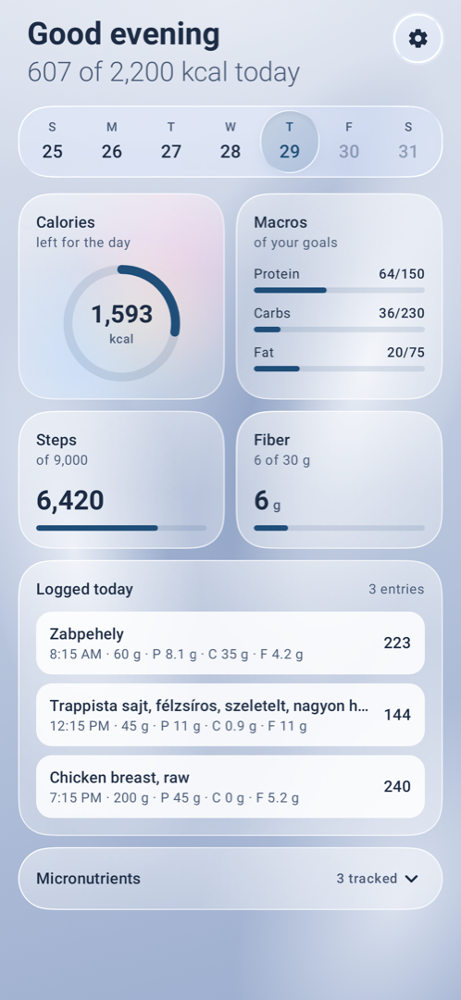
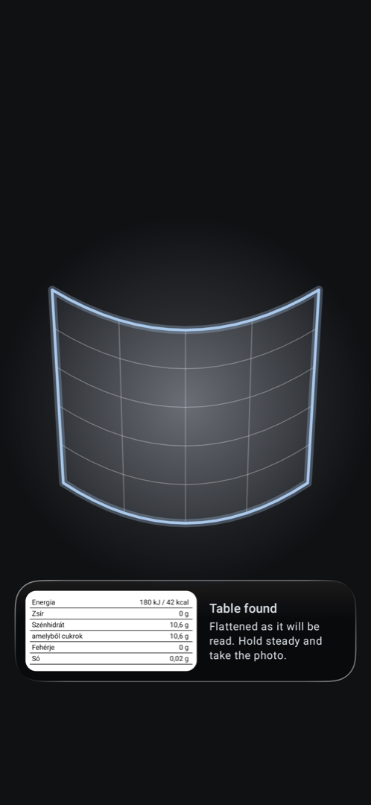
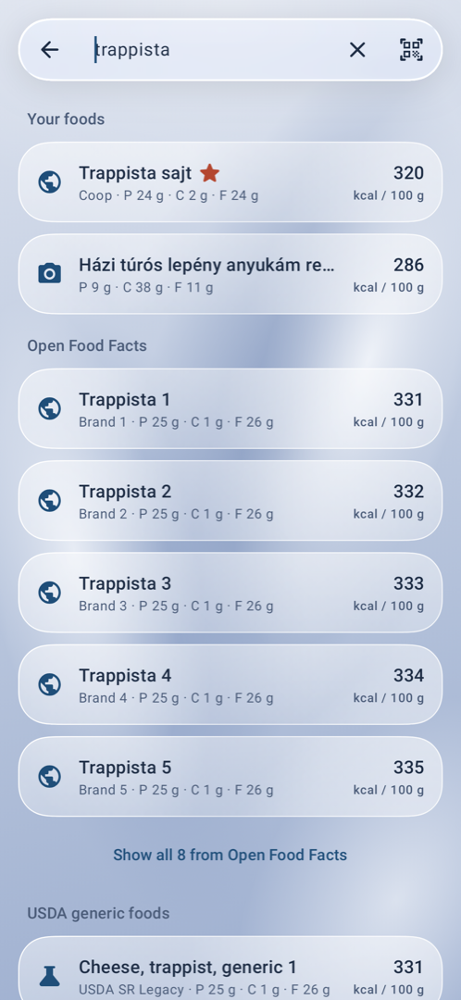
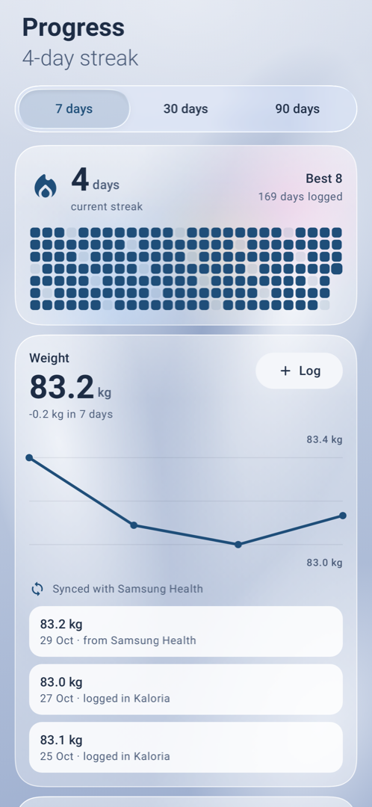
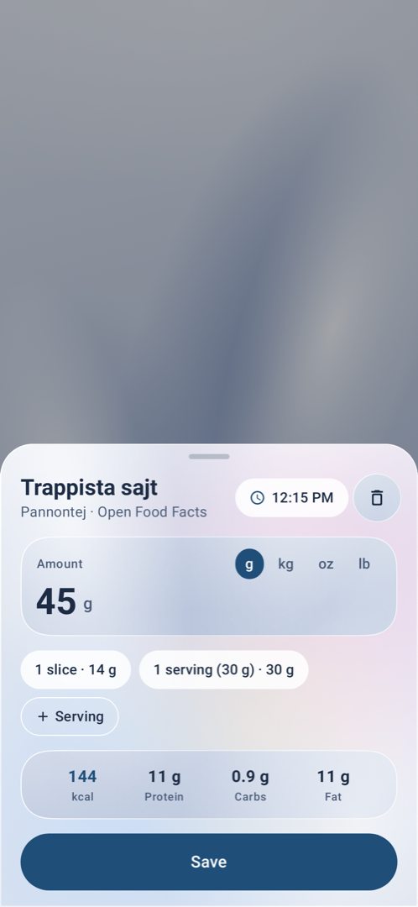
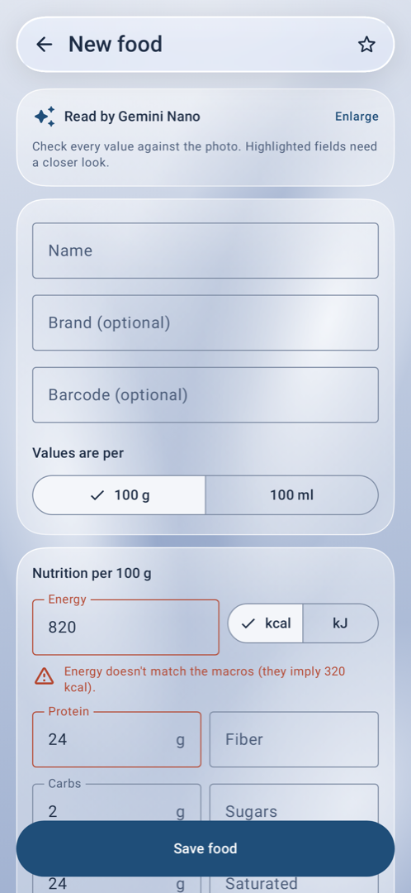
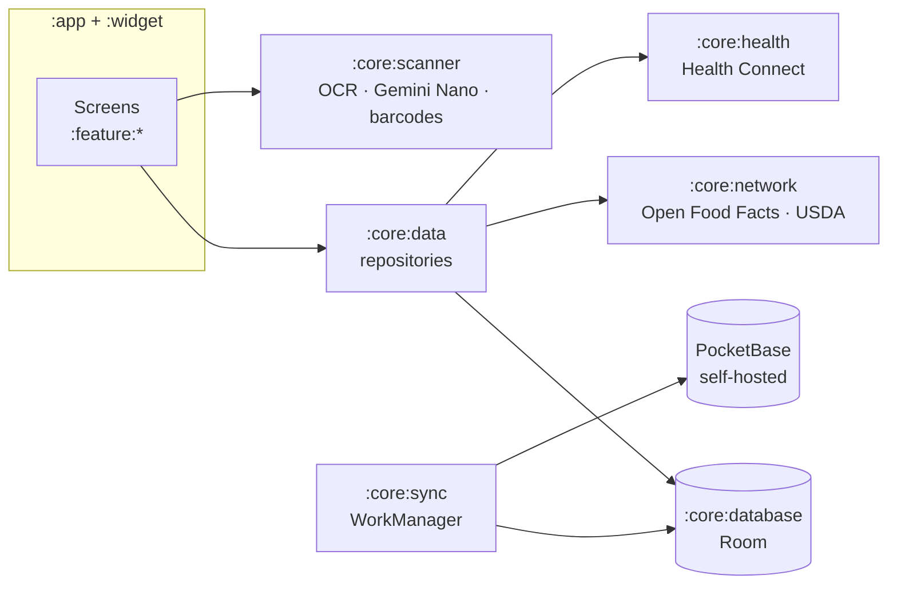

<div align="center">


# Kaloria

**A calorie and nutrition tracker for Android built on exact data.**

Scan a nutrition label or a barcode, log what you ate, and see where you stand.
Your targets, your numbers. Kaloria never guesses calories burned.

[](https://github.com/southstar21dev/Kaloria/actions/workflows/ci.yml)
[](https://github.com/southstar21dev/Kaloria/releases/latest)


[](LICENSE)

<a href="https://apps.obtainium.imranr.dev/redirect?r=obtainium://add/https://github.com/southstar21dev/Kaloria"></a>
<a href="https://github.com/southstar21dev/Kaloria/releases/latest"></a>

<br />






</div>

## Why Kaloria

Most trackers estimate: your daily burn, the calories in a workout, the contents of a photo of
your plate. Kaloria doesn't. It tracks what you can actually know: what's on the label, what you
weighed, and the targets **you** set. Steps are shown as a count, nothing more.

- **Read the label, not a guess.** Point the camera at a nutrition table. Kaloria finds it,
  flattens it even on a curved can, and reads it on the device.
- **Works offline.** Everything is stored on your phone first. Sync is optional.
- **Your data stays yours.** No account with us, no ads, no analytics. Sync goes to a
  PocketBase server you run yourself.
- **A calm, glassy interface.** Liquid Glass surfaces with real refraction, built in Compose.

## Features

<table>
<tr>
<td width="50%" valign="top">

### Today at a glance
Calories left, protein, carbs and fat against your goals, fiber, steps and micronutrients, with a
timeline of everything you logged. Swipe between days; tap an entry to change the amount or time.

</td>
<td width="50%" valign="top">

### Scan nutrition labels
ML Kit text recognition, then **Gemini Nano** on supported phones (Galaxy S24+, Pixel 9+), with a
rule-based parser for Hungarian, English, Turkish and Azerbaijani labels as the fallback. Values
land in an editor next to the photo, with doubtful fields highlighted: energy that doesn't match
the macros, sugars above carbs, AI and OCR disagreeing.

</td>
</tr>
<tr>
<td align="center"></td>
<td align="center"></td>
</tr>
<tr>
<td width="50%" valign="top">

### Barcodes and search
Scan a barcode: your own foods come first, then Open Food Facts; unknown products go straight to
a label scan. Search covers your foods, Open Food Facts (branded) and USDA FoodData Central
(generic) in one list. Online foods are copied into your database the first time you log them.

</td>
<td width="50%" valign="top">

### Progress, health and widget
Energy, macros, weight and steps over 7, 30 or 90 days, with your logging streak.
**Health Connect** brings in steps and syncs weigh-ins both ways with Samsung Health. A home-screen
widget shows calories left with one-tap Scan and Search.

</td>
</tr>
</table>

## Install

Kaloria is distributed through [GitHub Releases](https://github.com/southstar21dev/Kaloria/releases).

| | |
|---|---|
| **Recommended: [Obtainium](https://github.com/ImranR98/Obtainium)** | Tap the badge above (or add `https://github.com/southstar21dev/Kaloria` in Obtainium). It installs Kaloria and keeps it updated automatically. Set the APK filter to `arm64-v8a`. |
| **Manual** | Download `kaloria-<version>-arm64-v8a.apk` (~26 MB, practically every phone in use) or `kaloria-<version>-universal.apk` (~72 MB, older 32-bit phones and emulators) from the latest release. |

Requires Android 14 or newer. Release candidates from the `staging` branch are published as
pre-releases; enable *Include prereleases* in Obtainium to test them.

## Sync with your own server

Sync is optional and self-hosted. The [`server/`](server) folder holds a ready-made
[PocketBase](https://pocketbase.io) image with migrations and a last-write-wins hook.

```sh
cd server
PB_ADMIN_EMAIL=you@example.com PB_ADMIN_PASSWORD='a strong password' docker compose up -d
# Admin UI: http://localhost:8090/_/  (create your user there; public sign-up is disabled)
```

Then sign in under **Settings → Sync** with your server's address.

<details>
<summary>How sync works</summary>

- Room on the phone is the source of truth. WorkManager pushes local changes and pulls the
  server's, keeping whichever is newer (last-write-wins on the client timestamp, enforced by a
  server hook too).
- Ids are generated on the device in PocketBase's format (15 × `[a-z0-9]`), so a row created
  offline keeps its id on the server.
- Nutrients are stored as JSON, so "not on the label" stays distinct from zero.
- Debug builds talk to `http://10.0.2.2:8090` (the emulator's view of your machine) by default; on a
  phone on your LAN, enter the machine's IP. Android 17 asks once for local network access.

</details>

## Built with

Kotlin 2.4 · Jetpack Compose with Material 3 Expressive · Liquid Glass via
[Kyant's Backdrop](https://github.com/Kyant0/AndroidLiquidGlass) (AGSL refraction, specular
highlights) · Navigation 3 · Hilt · Room · DataStore · WorkManager · CameraX · ML Kit (barcode,
text, GenAI Prompt API) · Health Connect · Glance · Ktor · PocketBase.



<details>
<summary>All modules</summary>

| Module | Contents |
|---|---|
| `app` | Activity, Navigation 3 back stack, glass dock, widget shortcuts |
| `core:model` | Pure-Kotlin domain types and ids |
| `core:database` | Room entities and DAOs, each with `updatedAt` / `deleted` / `dirty` |
| `core:datastore` | Preferences, and the PocketBase session (token encrypted with a Keystore key) |
| `core:network` | HTTP only: Open Food Facts, USDA and PocketBase REST clients |
| `core:data` | Offline-first repositories, the food catalog, Health Connect weight sync and the steps facade features use |
| `core:sync` | Sync logic on top of `core:network`: engine, WorkManager worker and scheduler, account |
| `core:scanner` | OCR, Gemini Nano extraction, the rule-based label parser, barcode analysis |
| `core:health` | Health Connect access: step counts and weigh-ins (read and write) |
| `core:designsystem` | Theme, glass backdrop and surfaces, rings, bars and charts |
| `core:ui` | Shared composables (portion sheet, food row, number fields) |
| `feature:*` | `today`, `foodsearch`, `foods`, `scan`, `progress`, `settings` |
| `widget` | Glance home-screen widget |
| `build-logic` | Convention plugins |
| `server/` | PocketBase image, migrations and the last-write-wins hook |

</details>

## Development

Create `local.properties` (it isn't committed):

```properties
sdk.dir=/Users/you/Library/Android/sdk
usda.apiKey=YOUR_KEY                          # free at https://fdc.nal.usda.gov/api-key-signup; DEMO_KEY otherwise
pocketbase.debugUrl=http://192.168.1.20:8090  # optional: debug builds' server
```

```sh
./gradlew installDebug                     # dev.southstar21.kaloria.debug
./gradlew testDebugUnitTest                # unit tests, incl. label parser and sync engine
./gradlew :core:model:test                 # the plain-Kotlin module's tests
./gradlew verifyRoborazziDebug             # screenshot tests (baselines are recorded on Linux in CI)
./gradlew spotlessApply detekt lintDebug   # format, static analysis, lint
```

Every push runs CI: unit and screenshot tests, lint, detekt, formatting and an R8 release build.
Pushes to `staging` and `master` are released automatically by semantic-release with signed APKs.
See [CONTRIBUTING.md](CONTRIBUTING.md) for branches and commit messages, and
[docs/RELEASING.md](docs/RELEASING.md) for versions, signing and publishing.

## License

Kaloria is free software under the [GNU General Public License v3.0](LICENSE). You can use,
study, share and change it; if you distribute it or a modified version, you must do so under the
same license and with the source code. As an additional permission, it may be combined with Google
ML Kit and Google Play services, which are proprietary; see [NOTICE.md](NOTICE.md). Code adapted
from other projects keeps its original license (Apache-2.0 or MIT), as listed there.

## Credits

- Food data from [Open Food Facts](https://world.openfoodfacts.org) (ODbL) and
  [USDA FoodData Central](https://fdc.nal.usda.gov) (public domain).
- Liquid Glass rendering by [Kyant0/AndroidLiquidGlass](https://github.com/Kyant0/AndroidLiquidGlass) (Apache-2.0).
- [Get it on Obtainium](https://github.com/ImranR98/Obtainium) and [Get it on GitHub](https://github.com/Kunzisoft/Github-badge) badges by their respective projects.
